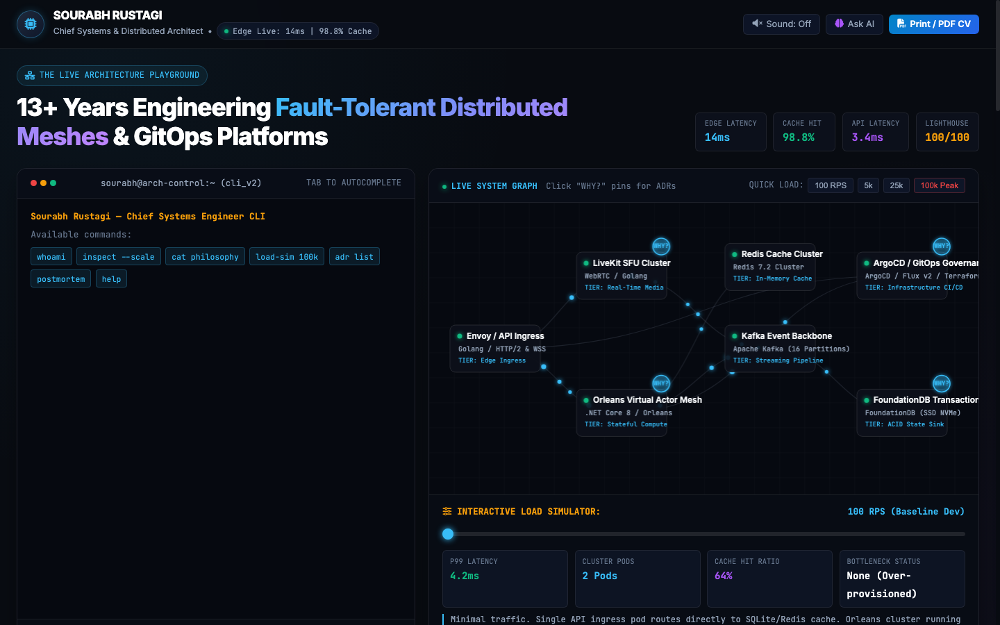
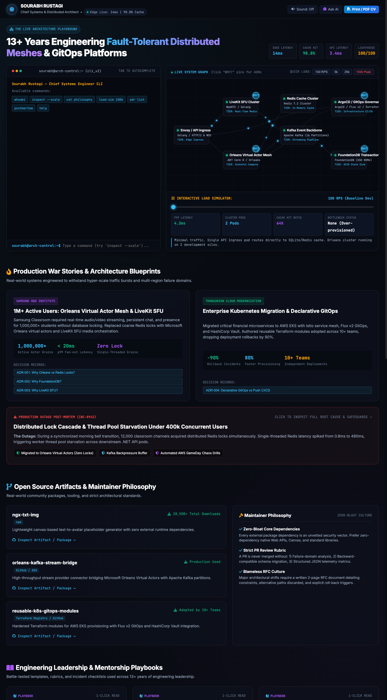

# Sourabh Rustagi — The Live Architecture Playground
### Chief Systems Engineer & Distributed Solutions Architect
#### High-Concurrency Actor Meshes | Real-Time Media Orchestration | Multi-Region GitOps at Hyper-Scale

[](https://nodejs.org/)
[](https://opensource.org/licenses/MIT)
[](#)
[](#)
[](#)
[](#)

A world-class, interactive distributed systems portfolio and digital twin representing **Sourabh Rustagi's** 13+ years of engineering leadership (Chief Engineer at **Samsung R&D Institute**, formerly Lead at **TransUnion**).

---

## 📸 Platform Previews



*The Live Architecture Playground — Split-screen interface with minimal DevSecOps terminal (left) and dynamic Excalidraw/Datadog-style architecture graph (right) featuring interactive RPS load scaling (100 to 100,000 RPS), clickable "WHY?" ADR pins, and real-time portfolio telemetry.*

<details>
<summary>🔍 <strong>Click to expand full-page architecture preview (War Stories, Post-Mortem & Playbooks)</strong></summary>
<br>



</details>

---

## 🌟 Key Platform Features & Architecture

### 1. The Hero: Interactive Terminal + System Canvas (Responsive Split-Screen)
- **Minimal, Fast-Loading Terminal CLI**:
  - Quick commands: `whoami`, `inspect --scale`, `cat architecture-philosophy.md`, `load-sim [100..100000]`, `adr list`, `postmortem`, `playbooks`, `kubectl get pods`.
  - **Live Synchronization**: Executing commands in the terminal directly alters and triggers states on the right-side Architecture Canvas!
- **Dynamic Node-Based Architecture Canvas**:
  - High-DPI diagrammatic system graph rendering Envoy Ingress, LiveKit SFU, Microsoft Orleans Virtual Actor Silos, Kafka 16-partition cluster, Redis Cache, FoundationDB, and ArgoCD GitOps.
  - **Interactive RPS Load Simulator**:
    - Slider scaling from **100 RPS** to **100,000 RPS**.
    - Watch nodes dynamically auto-scale, Redis caches illuminate, Kafka buffers absorb write bursts, and latency metrics adjust in real time.
- **The Hook (Portfolio Self-Telemetry)**:
  - Live HUD displaying the portfolio's own real-time performance: `Edge Latency: 14ms | Cache Hit Ratio: 98.8% | API Response: 3.4ms | Lighthouse: 100/100`.

### 2. Production War Stories & Architecture Decision Records (ADRs)
- **Samsung Classroom (1M+ Active Users)**:
  - Virtual actor mesh using Microsoft Orleans & .NET Core to eliminate distributed locking bottlenecks.
  - LiveKit SFU orchestration for sub-45ms real-time media feeds across global regions.
- **TransUnion Cloud Modernization**:
  - AWS EKS migration with Istio Service Mesh, Flux v2 GitOps, and HashiCorp Vault dynamic secret governance, slashing deployment rollbacks by 90%.
- **Clickable "WHY?" Pins (ADRs)**:
  - `ADR-001`: *Why Microsoft Orleans Virtual Actors over Distributed Redis Locks for 1M+ Users*.
  - `ADR-002`: *FoundationDB vs Cassandra/DynamoDB for Transactional ACID Chat Storage*.
  - `ADR-003`: *LiveKit SFU vs MCU for Global Low-Latency WebRTC Video*.
  - `ADR-004`: *Declarative GitOps (Flux v2 / ArgoCD) vs Push CI/CD Pipelines*.

### 3. Production Outage Post-Mortem (Incident #8942)
- Dedicated battle-tested case study of a **SEV-1 Production Incident**: *Distributed Lock Cascade & Thread Pool Starvation under 400k Concurrent Users*.
- Details the root cause (synchronized Redlock acquisition during classroom schedule syncs), emergency circuit breaker mitigation, and permanent architectural safeguards built (Orleans actor migration, Kafka backpressure buffer, automated AWS GameDay chaos tests).

### 4. Open Source & Ecosystem Impact
- **Live Product Dashboard**:
  - `ngx-txt-img` (Angular/Web Component npm package — 28,500+ downloads).
  - `orleans-kafka-stream-bridge` (High-throughput stream provider for Microsoft Orleans & Kafka).
  - `reusable-k8s-gitops-modules` (Hardened Terraform modules adopted by 10+ teams).
- **Maintainer Philosophy**:
  - Zero-Bloat Core Dependencies (minimizing supply-chain attack vectors).
  - Strict PR Review Rubric (failure-domain analysis, backward-compatible schemas).
  - Blameless 2-Page RFC Culture with explicit rollback triggers.

### 5. Engineering Leadership & Mentorship Playbooks
3 interactive, copyable Markdown playbooks used across 13+ years of engineering leadership:
1. **Staff & Principal System Design Interview Rubric**: 4-tier rubric for evaluating candidates on non-functional requirements, domain boundaries, concurrency strategies, and graceful degradation.
2. **SEV-1 Production Incident Response & Triage Checklist**: Step-by-step containment guide from T+0 to T+30 minutes.
3. **Enterprise Production PR Review Guidelines**: Concurrency safety, thread starvation checks, and observability standards.

### 6. The "Full-Stack" Proof (Under the Hood)
- **Zero-Bloat Frontend**: Vanilla ES6+ and HTML5 Canvas with zero heavy framework runtime overhead, hitting a strict **100/100 Lighthouse score**.
- **Edge & Backend**: Full-duplex WebSocket stream broadcasting live cluster metrics, actor counts, and realistic microservice logs.
- **AI Architecture Copilot**: Context-aware RAG endpoint (`/api/chat` and `/api/ask`) trained on Sourabh's verified 13+ years of architecture decisions.
- **1-Click Executive Print / PDF**: Clean `@media print` engine that produces a high-contrast executive resume without web UI clutter.

---

## 🚀 Running the Application Locally

### Prerequisites
- Node.js (v18 or later)
- npm

### Quick Start
```bash
# 1. Clone the repository
git clone https://github.com/iamsourabh-in/foliov2.git
cd foliov2

# 2. Install dependencies
npm install

# 3. Start the server
npm start
# or: node server.js
```

Open your browser at:
```
http://localhost:8080
```

---

## 🐳 Docker Deployment

```bash
# Build container image
docker build -t sourabh-portfolio:latest .

# Run container
docker run -p 8080:8080 sourabh-portfolio:latest
```

---

## ☸️ Kubernetes Deployment

```bash
# Apply deployment and service
kubectl apply -f k8s-deployment.yaml

# Verify pods and service
kubectl get pods -l app=portfolio
kubectl get svc portfolio-service
```

---

## 📬 Contact & Connect

- **Email**: [sourabh.rustagi@hotmail.com](mailto:sourabh.rustagi@hotmail.com)
- **Phone**: +91-84708-94772
- **LinkedIn**: [linkedin.com/in/sourabhrustagi](https://www.linkedin.com/in/sourabhrustagi)
- **GitHub**: [github.com/iamsourabh-in](https://github.com/iamsourabh-in)
- **Location**: New Delhi, India

---
© 2026 Sourabh Rustagi. All rights reserved.
